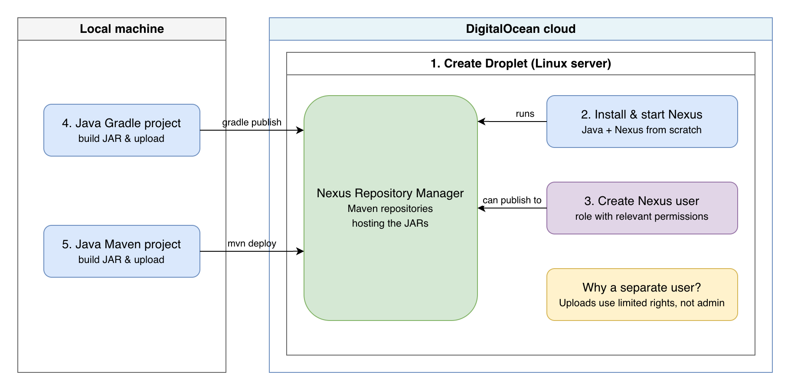

Run Nexus on DigitalOcean and Publish Artifacts

Installed Nexus Repository Manager on a DigitalOcean Droplet and published build artifacts to it from Java Gradle and Maven projects.

**Tech:** Nexus · DigitalOcean · Linux · Java · Gradle · Maven

## What I did

- Installed and configured Nexus from scratch on a cloud server (Droplet)
- Created a dedicated Nexus user with limited, role-based permissions
- Built a Java Gradle project and uploaded the JAR to Nexus
- Built a Java Maven project and uploaded the JAR to Nexus

## Skills demonstrated

Artifact repository management, Linux administration, cloud infrastructure, build automation with Gradle and Maven, access control (least privilege)
